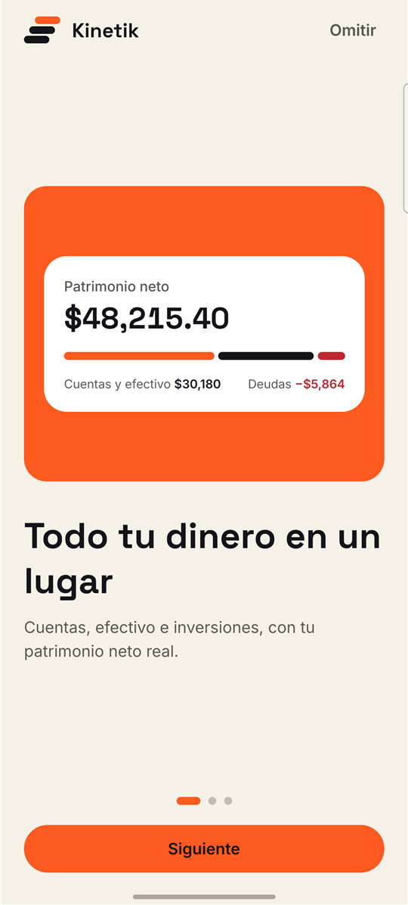

<div align="center">
  

# Kinetik

**Finanzas personales para México.** Tus cuentas, tarjetas de crédito, suscripciones y
presupuestos en un solo lugar, con tu patrimonio neto real.

</div>

<p align="center">
  
  
  
</p>

## Funciones

- **Cuentas y patrimonio**: cuentas bancarias, efectivo, inversiones y tarjetas de crédito,
  agrupadas por banco, con lo que tienes frente a lo que debes.
- **Tarjetas de crédito**: fecha de corte y de pago, cuánto pagar en cada periodo y avisos
  antes de que venza.
- **Meses sin intereses**: compras a MSI repartidas mes a mes en el corte y en tus presupuestos.
- **Movimientos**: gastos, ingresos y transferencias entre cuentas, con categorías.
- **Suscripciones**: cargos mensuales, trimestrales o anuales que se registran solos.
- **Presupuestos**: límite mensual por categoría, cuánto llevas y cuánto puedes gastar al día.
- **Análisis**: flujo de efectivo, proyección y gasto por categoría de cada mes.
- **Metas**: junta para un viaje o un enganche, solo o en pareja, con las aportaciones de cada
  quien y cuánto ahorrar al mes para llegar.
- **En pareja**: comparte cuentas con un código de invitación, vean sus movimientos en tiempo
  real con avisos push y filtren Análisis y Movimientos por lo personal o lo compartido.
- **Privacidad**: bloqueo con huella o Face ID y botón para ocultar todos los montos.
- **Atajos**: widget de Android y acciones rápidas desde el ícono para registrar un gasto.

## Stack

| Capa          | Tecnología                                                                 |
| ------------- | -------------------------------------------------------------------------- |
| App           | [Expo](https://expo.dev) SDK 58, React Native, Expo Router, React Compiler |
| UI            | NativeWind (Tailwind), Inter y Space Grotesk, tema claro y oscuro          |
| Datos         | TanStack Query, Zustand, MMKV                                              |
| Formularios   | React Hook Form + Zod                                                      |
| Backend       | [Supabase](https://supabase.com): Postgres con RLS, Auth, Realtime, Edge Functions |
| Autenticación | Correo y contraseña, Google Sign-In                                        |

## Empezar

Requisitos: [Bun](https://bun.sh), un proyecto de Supabase y un teléfono o emulador con un
[development build](https://docs.expo.dev/develop/development-builds/introduction/) (la app usa
módulos nativos, no corre en Expo Go).

```bash
bun install
cp .env.example .env   # llena las variables de Supabase y Google
```

Aplica las migraciones de `supabase/migrations` a tu proyecto:

```bash
bunx supabase link --project-ref <tu-project-ref>
bunx supabase db push
```

Compila e instala el development build una vez, y después solo arranca Metro:

```bash
bun run android        # o: bunx eas-cli build --profile development
bun run start
```

## Scripts

| Comando             | Qué hace                         |
| ------------------- | -------------------------------- |
| `bun run start`     | Arranca Metro                    |
| `bun run android`   | Compila y abre la app en Android |
| `bun run ios`       | Compila y abre la app en iOS     |
| `bun run lint`      | ESLint                           |
| `bun run typecheck` | TypeScript sin emitir            |
| `bun run test`      | Pruebas con Jest                 |
| `bun run format`    | Prettier                         |

## Estructura

```
src/
├── app/          # Pantallas (Expo Router): (auth) antes del login, (app) después
├── features/     # Un módulo por dominio: accounts, transactions, budgets, household…
├── components/   # UI compartida
├── stores/       # Estado global (sesión, ajustes)
├── lib/          # Cliente de Supabase, fechas, formato
└── widgets/      # Widget de Android
supabase/
├── migrations/   # Esquema, RLS y funciones de Postgres
└── functions/    # Edge Functions
```
